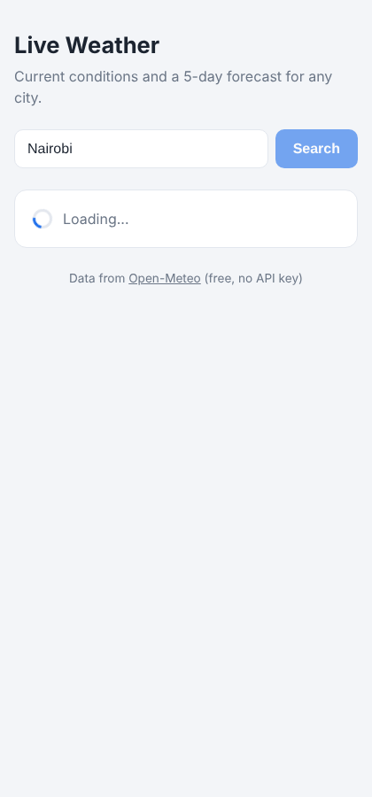
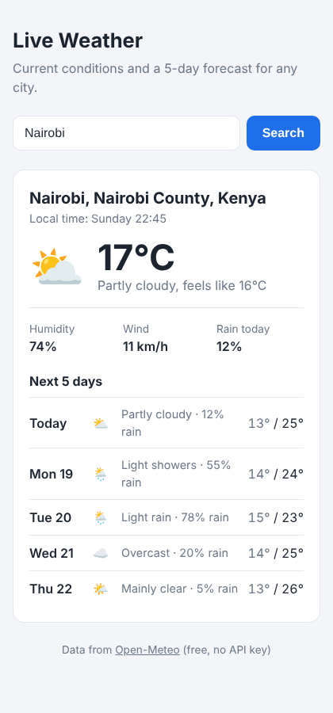
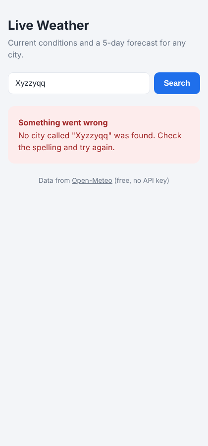

# Live Weather

A web page that shows the current weather and a 5-day forecast for any city, using live data from the free [Open-Meteo](https://open-meteo.com) API (no API key needed).

AI Masterclass 2, Phase II, Week 1, Day 4: integrating live API data into a web page with JavaScript's Fetch API.

**Live demo:** https://billrawknow.github.io/weather-web/

## The problem it solves

Checking the weather for a trip or a client visit usually means wading through ad-heavy sites. This page does one job: type a city and get a clean summary of the weather now and the next five days, on any device.

## How it works

Two chained `fetch()` calls using `async/await`:

1. **Geocoding API**: turns the city name into latitude and longitude.
2. **Forecast API**: uses those coordinates to get the current weather and the 5-day forecast.

The page handles all three states of a request:

| State | What you see |
|---|---|
| Loading | A spinner and "Loading...", and the Search button is disabled so it can't be clicked twice |
| Success | Location, temperature, conditions, humidity, wind and a 5-day forecast |
| Error | A red message explaining what went wrong |

Errors handled:
- **City not found:** type something like `Xyzzyqq` to see it
- **Empty search box**
- **No internet connection**
- **Server error:** any HTTP error status from the API

## Screenshots

| Loading | Success | Error |
|---|---|---|
|  |  |  |

## How to run

There's nothing to install. Either:

- Double-click `index.html` to open it in your browser, or
- Visit the live demo link above.

## Built with

Plain HTML, CSS and JavaScript (no frameworks): `fetch()`, `async/await`, `try/catch`, and `URLSearchParams`. Supports light and dark mode and works on phones.

